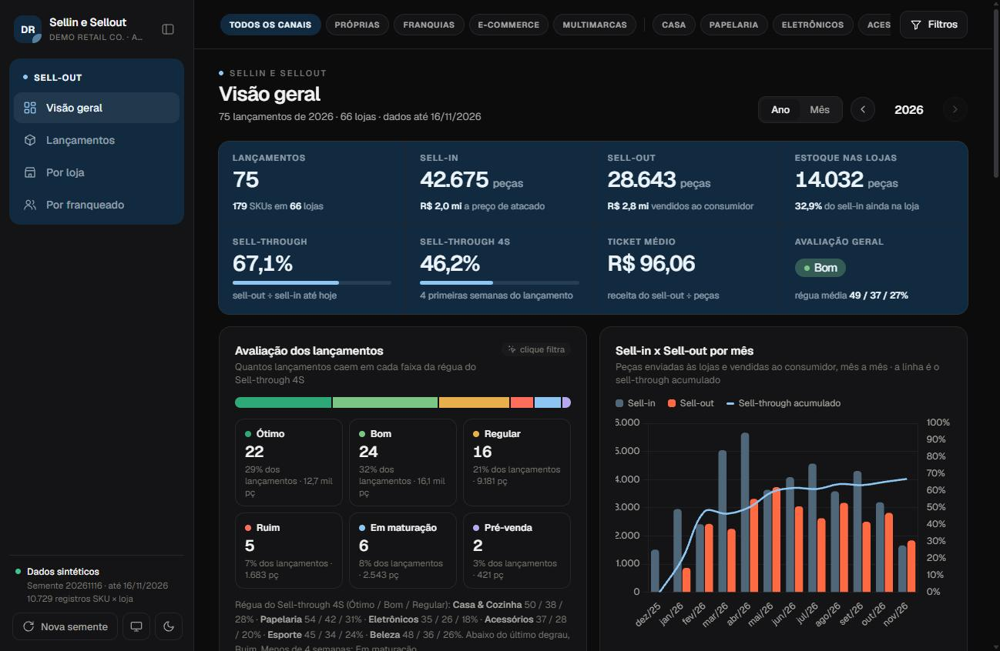

# Sellin e Sellout · Demo Retail Co.

**▶ [Demo ao vivo](https://viniboricuo.github.io/sellin-sellout-analytics/)** · [Modo TV](https://viniboricuo.github.io/sellin-sellout-analytics/tv.html) · sell-in × sell-out · sell-through 4S · filtros em cascata · exportação para Excel

**Em números:** 4 canais (lojas próprias, franquias, e-commerce e multimarcas) · 4 páginas + modo TV com 4 painéis · régua de sell-through 4S por categoria · ~10 mil registros SKU × loja por semente

> **Disclaimer:** Projeto de portfólio. Marca, dados e código fictícios, gerados sinteticamente; não contém código, dados, fotos ou logos de nenhuma empresa.

## English

**What it is.** A static, internal-style analytics dashboard that compares **sell-in** (units shipped by the brand to stores) with **sell-out** (units sold by stores to consumers) for product launches of a fictional general retail brand, *Demo Retail Co.* (mixed categories: home & kitchen, stationery, electronics, accessories, sports and beauty), across four channels: own stores, franchises, e-commerce and multibrand partners. It has four pages (Overview, Launches, By store, By franchisee), a light/dark theme and a **TV mode** with large auto-rotating panels and a ticker.

**Metrics**

| Metric | Definition |
|---|---|
| Sell-in | Units shipped to stores (initial shipment one week before launch + replenishments) |
| Sell-out | Units sold by stores to consumers |
| Sell-through | Sell-out ÷ sell-in, cumulative to the data date |
| Sell-through 4S | Sales in the first 4 weeks ÷ initial shipment (only launches with 4 complete weeks) |
| Stock at store | Sell-in − sell-out |
| Rating | Sell-through 4S against a per-category threshold: Ótimo / Bom / Regular / Ruim; "Em maturação" under 4 weeks; "Pré-venda" before launch |

**Cascading filters.** Store filters go **channel → region → store** and product filters go **category → collection → SKU**. Each filter narrows the options of the next one, and when an upper filter changes, lower selections that no longer exist are dropped automatically. Charts, cards and table rows also filter on click (Ctrl+click adds items). Every table has an **Excel export**: a CSV with a UTF-8 BOM, `;` separator and decimal comma, generated in the browser.

**How to run.** No build step and no backend.

- Double-click `index.html` (works from `file://`), or
- publish the folder on GitHub Pages (all paths are relative), or
- serve it locally: `python -m http.server 8000` and open `http://localhost:8000`.

TV mode: open `tv.html` (or the TV button in the sidebar). Keys: ← → switch panels, space pauses. `tv.html?s=20` sets 20 s per panel; `?p=3` opens on the third panel. `?seed=123` (both pages) generates a different synthetic dataset. Chart.js 4.4.1 (cdnjs) and the Geist font (Google Fonts) load from the internet; without them the dashboard still works, with a notice in place of the charts and a system font.

**About the original concept.** The original concept was a Flask + SQL dashboard reading a relational database. This demo is a **static rebuild from scratch with synthetic data**: a seeded (deterministic) generator in `js/data.js` creates channels, regions, stores, franchisees, launches/SKUs, dates, sell-in and sell-out, with a realistic sell-through curve (sales are capped by store stock, so sell-out always lags sell-in).

### Files

| File | Role |
|---|---|
| `index.html`, `css/app.css`, `js/app.js` | Dashboard: sidebar, top chips, filter panel, period navigation, KPI band, charts, tables, detail drawer |
| `tv.html`, `css/tv.css`, `js/tv.js` | TV mode: 4 rotating panels (Summary, Channels, Showcase, Curve) and a ticker |
| `js/data.js` | Seeded synthetic data generator |
| `js/core.js` | Shared measures, formatting (pt-BR), monthly series, week curve, geometric product art |

---

## Português (pt-BR)

**O que é.** Um painel estático, com cara de painel interno, que compara o **sell-in** (peças enviadas pela marca às lojas) com o **sell-out** (peças vendidas pelas lojas ao consumidor) nos lançamentos de uma marca fictícia de varejo geral, a *Demo Retail Co.* (categorias variadas: casa & cozinha, papelaria, eletrônicos, acessórios, esporte e beleza), em quatro canais: lojas próprias, franquias, e-commerce e multimarcas. Tem quatro páginas (Visão geral, Lançamentos, Por loja, Por franqueado), tema claro/escuro e um **Modo TV** com painéis grandes que giram sozinhos e uma fita.

**Medidas**

| Medida | Definição |
|---|---|
| Sell-in | Peças enviadas às lojas (remessa inicial uma semana antes do lançamento + reposições) |
| Sell-out | Peças vendidas pela loja ao consumidor |
| Sell-through | Sell-out ÷ sell-in, acumulado até a data dos dados |
| Sell-through 4S | Vendas das 4 primeiras semanas ÷ remessa inicial (só lançamentos com as 4 semanas completas) |
| Estoque na loja | Sell-in − sell-out |
| Avaliação | Sell-through 4S contra a régua da categoria: Ótimo / Bom / Regular / Ruim; "Em maturação" com menos de 4 semanas; "Pré-venda" antes do lançamento |

**Filtros em cascata.** Os filtros de loja seguem **canal → região → loja** e os de produto **categoria → coleção → SKU**. Cada filtro limita as opções do próximo; quando um filtro de cima muda, as escolhas de baixo que deixaram de existir saem sozinhas. Gráficos, cartões e linhas de tabela também filtram ao clicar (Ctrl+clique soma itens). Toda tabela tem **Baixar Excel**: CSV com BOM UTF-8, separador `;` e vírgula decimal, gerado no navegador.

**Como rodar.** Sem build e sem servidor de aplicação.

- Dê dois cliques em `index.html` (funciona em `file://`), ou
- publique a pasta no GitHub Pages (todos os caminhos são relativos), ou
- sirva localmente: `python -m http.server 8000` e abra `http://localhost:8000`.

Modo TV: abra `tv.html` (ou o botão de TV no menu). Teclas: ← → trocam o painel, espaço pausa. `tv.html?s=20` deixa 20 s por painel; `?p=3` abre no terceiro painel. `?seed=123` (nas duas páginas) gera outro conjunto de dados sintéticos. O Chart.js 4.4.1 (cdnjs) e a fonte Geist (Google Fonts) vêm da internet; sem eles o painel continua funcionando, com um aviso no lugar dos gráficos e a fonte do sistema.

**Sobre o conceito original.** O conceito original era um painel em Flask + SQL lendo um banco relacional. Esta demo é uma **reconstrução estática, escrita do zero, com dados sintéticos**: um gerador com semente (determinístico) em `js/data.js` cria canais, regiões, lojas, franqueados, lançamentos/SKUs, datas, sell-in e sell-out, com uma curva de sell-through realista (a venda é limitada pelo estoque da loja, então o sell-out sempre vem depois do sell-in).

## Licença

MIT. Veja [LICENSE](LICENSE).
